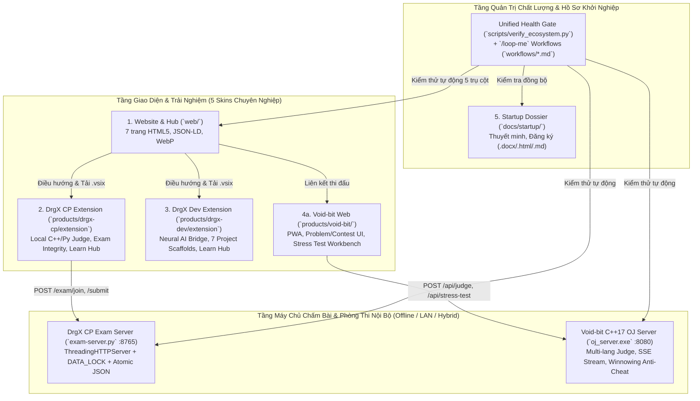

# Kiến Trúc Hệ Sinh Thái Khởi Nghiệp DrgX (`ARCHITECTURE.md`)

Tài liệu này mô tả kiến trúc tổng thể, luồng dữ liệu, cơ chế bảo mật và hệ thống `/loop-me` tự động hóa cho toàn bộ hệ sinh thái **DrgX**.

---

## 1. Sơ Đồ Kiến Trúc Tổng Thể (5 Trụ Cột)

---

## 2. Phân Lớp Chi Tiết Từng Trụ Cột

### 2.1. Website Thương Hiệu & Cổng Sản Phẩm (`web/`)
- **Cấu trúc**: 6 trang HTML tĩnh (`index.html`, `features.html`, `download.html`, `about.html`, `void-bit.html`, `judge-demo.html`) + Learn Hub (`ecosystem/index.html`), dùng chung hệ thống Design Tokens `web/assets/site.css` (v2.0) và `web/assets/site.js` (v2.0).
- **SEO & Hiệu năng**: Đầy đủ `robots.txt`, `sitemap.xml`, `_headers` (HSTS, CSP, X-Frame-Options, Cache-Control), Open Graph, Twitter Card, JSON-LD (`Organization`, `SoftwareApplication`, `FAQPage`, `WebApplication`), và ảnh `.webp`.
- **Hệ thống Skin**: Đồng bộ `localStorage.getItem('drgx.skin')` xuyên suốt các trang với 5 bảng màu chuyên nghiệp chống mỏi mắt.

### 2.2. DrgX CP (`products/drgx-cp/`)
- **DrgX CP Extension (`extension/`)**:
  - Đóng gói không phụ thuộc `node_modules` ngoài, dung lượng nhẹ (`~30 KB` `.vsix`).
  - Hỗ trợ chấm bài **Local** (biên dịch C++17 qua `g++` hoặc kiểm tra cú pháp Python qua `py_compile`, chạy song song các cặp `.in` + `.out`/`.ans`/`.a` được sắp xếp thứ tự tự nhiên) và **Server-Authoritative** (gửi bài lên `exam-server.py`).
  - Tích hợp 5 bộ Color Theme JSON chính thức đồng bộ với Web & Void-bit.
- **Classroom Exam Server (`server/exam-server.py`)**:
  - Sử dụng `ThreadingHTTPServer` xử lý đồng thời nhiều học sinh nộp bài trong phòng máy LAN.
  - Cơ chế khóa `DATA_LOCK = threading.Lock()` kết hợp ghi file nguyên tử (`os.replace` qua file `.tmp`) bảo vệ `exams.json` khỏi xung đột ghi.
  - Giới hạn kích thước body (`MAX_BODY_BYTES = 512 KB`, trả `HTTP 413`) và kiểm soát biểu thức chính quy `SAFE_CODE_RE` cho mã phòng thi.

### 2.3. DrgX Dev (`products/drgx-dev/`)
- **DrgX Dev Extension (`extension/`)**:
  - Khởi tạo nhanh 7 mẫu dự án thực tế (Web Starter, REST API Express, Python CLI, C++17 CMake, React Vite, Fullstack Monorepo, Discord/Telegram Bot) kèm `.vscode/tasks.json` và `.vscode/launch.json`.
  - **Toolchain Doctor**: Tự động dò `node`, `npm`, `python`, `pip`, `git`, `g++`, `code` trên PATH và đưa ra hướng dẫn khắc phục.
  - **Learn Hub (`Ctrl+Alt+L`)**: Cẩm nang lộ trình từ Competitive Programming sang Software Engineering ngay trong Studio Webview.

### 2.4. Void-bit Platform & C++17 OJ (`products/void-bit/`)
- **Web Frontend (`serve.js` trên cổng `8000`)**:
  - Giao diện luyện tập (`problems.html`, `problem.html`), thi đấu (`contests.html`, `contest.html`), bảng xếp hạng (`leaderboard.html`), và trạm Stress Test độc lập (`stresstest.html`).
  - Đã bảo vệ chống Path Traversal trong `serve.js` và đồng bộ 5 Skins (`css/cppro-theme.css`, `js/cppro-ui.js`).
- **C++17 OJ Backend (`OJ/oj_server.cpp` → `OJ/oj_server.exe` trên cổng `8080`)**:
  - Chấm bài đa ngôn ngữ (C++17, C11, Python 3, Java) với đo thời gian thực thi và bộ nhớ đỉnh (`GetProcessMemoryInfo` / `psapi`).
  - Hỗ trợ phát luồng kết quả trực tiếp từng testcase qua **Server-Sent Events (`text/event-stream`)**.
  - Thuật toán chống đạo văn **Winnowing k-gram fingerprinting** (`/api/anti-cheat/compare`, `/api/anti-cheat/scan`).
  - Hệ thống **Differential Stress Testing** (`/api/stress-test`) tự động biên dịch `generator`, `brute`, `solution` để tìm phản ví dụ.

### 2.5. Cơ Chế Bảo Mật Trọng Tâm
1. **Chống Command Injection (`sanitize_compiler_path`)**: Trong `oj_server.cpp`, tham số `compiler_path` từ JSON request được kiểm tra nghiêm ngặt (chỉ cho phép ký tự đường dẫn an toàn và tên trình biên dịch hợp lệ `g++`/`clang++`), ngăn chặn hoàn toàn việc chèn lệnh shell qua `_popen`.
2. **Bảo vệ Bộ nhớ & Chống DoS (`Content-Length` Guard)**:
   - `oj_server.cpp` bọc `std::stoi` trong `try/catch`, từ chối header phi số (`HTTP 400`) và giới hạn payload tối đa `2 MB` (`HTTP 413`).
   - `exam-server.py` giới hạn payload tối đa `512 KB` (`HTTP 413`).
3. **Admin Guard (`DRGX_ADMIN_TOKEN` + Loopback Default)**:
   - Các API quản trị (`POST /exam/create`, `POST /api/reload`, `POST /api/generate`) yêu cầu header `X-DrgX-Admin-Token` (hoặc `Authorization: Bearer`) nếu biến môi trường `DRGX_ADMIN_TOKEN` được cấu hình; nếu không cấu hình (mặc định khi chạy demo 1-click), chỉ cho phép kết nối từ loopback (`127.0.0.1` / `::1`).

---

## 3. Quy Trình Tự Động Hóa `/loop-me` & Kiểm Thử

| Công cụ / Quy trình | Đường dẫn | Mục đích |
| :--- | :--- | :--- |
| **Unified Health Gate** | `scripts/verify_ecosystem.py` | Chạy toàn bộ kiểm thử tự động 5 trụ cột và xuất báo cáo `workflows/reports/ecosystem-health-brief.md` |
| **Demo Doctor** | `scripts/demo-doctor.ps1` | Kiểm tra toolchain, tự động biên dịch `oj_server.exe` nếu cần, chạy Health Gate và khởi động 3 server demo |
| **CI Pipeline** | `.github/workflows/ci.yml` | Tự động build C++17 OJ và chạy `verify_ecosystem.py` trên GitHub Actions (`windows-latest`) |
| **Root Workflows** | `workflows/*.md` | Đặc tả 8 phần cho `ecosystem-health-gate`, `contest-demo-readiness`, `startup-dossier-sync` |
| **Void-bit Sub-Workflows** | `products/void-bit/workflows/*.md` | 9 vòng lặp chuyên sâu cho Void-bit (Judge ping, Anti-cheat, Stress test, Database, PWA) |
